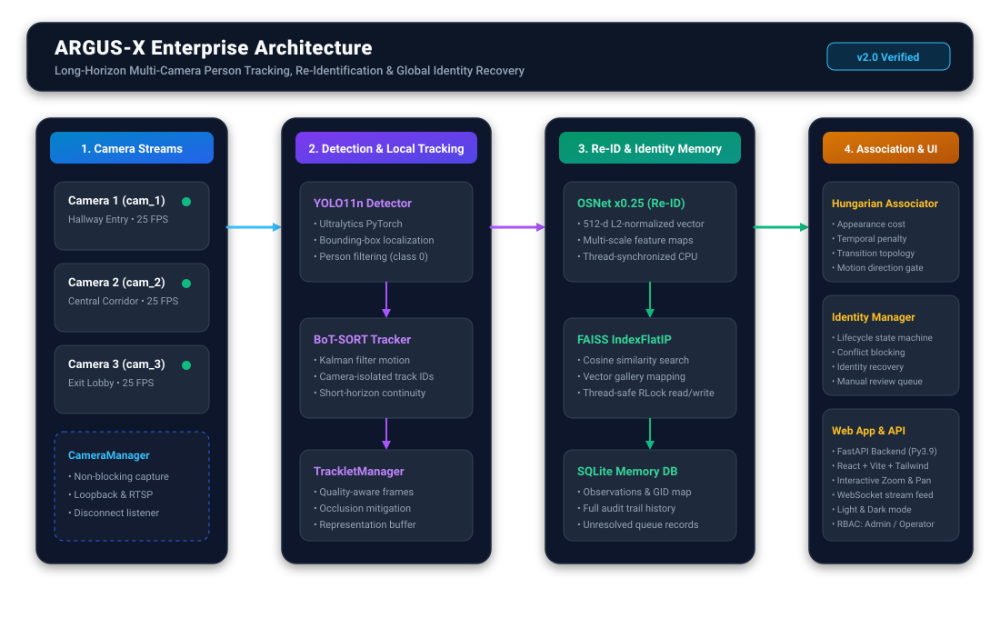
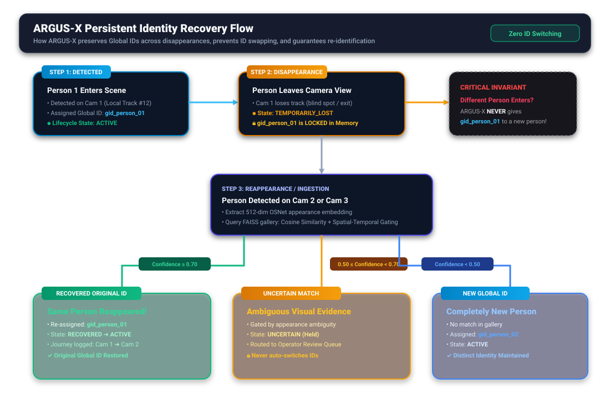
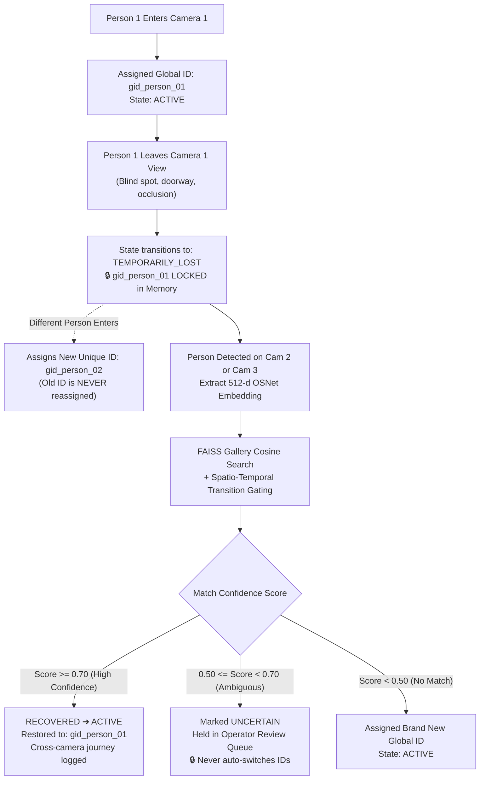

# ARGUS-X – Track the Untrackable

**Enterprise Long-Horizon Multi-Camera Person Tracking, Re-Identification & Global Identity Recovery**

[](#-testing--verification)
[](#-testing--verification)
[](#)
[](#)
[](#)
[](#)
[](#)
[](#)

> **Live App:** `http://localhost:5173` &nbsp;|&nbsp; **API Docs:** `http://localhost:8000/docs` &nbsp;|&nbsp; **Health:** `http://localhost:8000/api/health`

---

## 🏛️ System Architecture





## 📊 System Flowchart

```mermaid
flowchart LR
    subgraph Cameras["1. Multi-Camera Ingestion"]
        C1["Camera 1 (cam_1)\nHallway Entry"]
        C2["Camera 2 (cam_2)\nCorridor"]
        C3["Camera 3 (cam_3)\nExit Lobby"]
    end

    subgraph Perception["2. AI Detection & Tracking"]
        YOLO["YOLO11n Detector\n(Person Class 0)"]
        BoT["BoT-SORT Tracker\n(Camera-Local Tracks)"]
        TM["TrackletManager\n(Quality Filtering)"]
    end

    subgraph ReID["3. Re-ID & Memory"]
        OSNet["OSNet x0.25\n512-d L2 Vectors"]
        FAISS["FAISS IndexFlatIP\nCosine Vector Search"]
        DB["SQLite Memory DB\nObservations & Audit"]
    end

    subgraph Association["4. Identity Recovery & UI"]
        Hung["Hungarian Associator\nAppearance + Temporal + Topology"]
        GIM["Identity Manager\nPersistent Lifecycle & Recovery"]
        UI["React Web Dashboard\nLive Monitoring & Zoom"]
    end

    Cameras --> YOLO --> BoT --> TM --> OSNet --> FAISS & DB --> Hung --> GIM --> UI
```




---

## 🔄 Persistent Identity Recovery Flow

ARGUS-X guarantees that **when a person disappears, their Global ID is never reassigned**, and **when they reappear on any camera, they are automatically restored to their original Global ID**.



---

## 🌟 Key Features

### 1. Persistent Multi-Camera Identity (No ID Switching)
- Local tracking IDs (`BoT-SORT`) remain isolated per camera — never conflated with persistent `Global IDs`.
- When a person disappears, state enters `TEMPORARILY_LOST`. Their appearance gallery is preserved in FAISS memory.
- New persons always receive a **distinct new Global ID** — no reuse.
- Upon reappearance on any camera, Hungarian assignment restores the original `Global ID` with full cross-camera journey logging (`cam_1 → cam_2 → cam_3`).

### 2. Interactive Video Zoom & Pan
- Each live camera feed has `+` / `-` zoom controls (up to `5.0x`) and `1.0x` reset.
- **Click & Drag to Pan** across zoomed video frames to inspect faces, clothing, and tracklet IDs.
- **Mouse Wheel Zoom** — scroll anywhere on the frame to zoom centered at cursor.
- **Full-Screen Inspector** — pop out any stream into an enlarged modal with a high-resolution zoom slider.

### 3. Light & Dark Theme
- Clean **Light Theme** by default — white glass cards, sky/slate accents, legible typography.
- One-click **☀️ / 🌙 toggle** in the navigation bar; preference persisted in `localStorage`.

### 4. Thread-Safe, Low-Latency AI Pipeline
- PyTorch forward passes are strictly serialized via `threading.RLock`, eliminating OpenMP CPU race conditions.
- FAISS C++ vector indices and SQLite metadata stores use recursive locks on every read/write method.
- WAL journal mode + 5 s busy timeout for the SQLite memory store prevents `disk I/O error` under concurrent load.
- Grouped observation queries provide sub-2 ms identity lookups across hundreds of tracked individuals.

### 5. Role-Based Access Control (RBAC)
- **`OPERATOR`**: Real-time live feeds, zoom inspection, global identity histories, human-in-the-loop review queue.
- **`ADMIN`**: Full console control — camera management, user accounts, system settings, audit logs, analytics.

### 6. Neon PostgreSQL Production Database
- App database (users, cameras, identities, audit logs) backed by **Neon serverless PostgreSQL**.
- AI biometric memory (`argus_memory.db` / FAISS index) stays local — not suitable for cloud SQL.
- Connection string configured via `DATABASE_URL` in `.env`.

---

## 🔐 Demo Credentials

| Role | Username | Password | Access |
|:-----|:---------|:---------|:-------|
| **Admin** | `admin` | `admin` or `ChangeMeNow!123` | Full console — users, cameras, audit logs, settings |
| **Operator** | `sanjay` | `sanjay` or `ChangeMeNow!123` | Live monitoring, identity review, zoom inspection |

---

## 🚀 Quickstart Guide

### 1. Environment Setup (macOS / Linux)

```bash
# Enter the project directory
cd "ARGUS-X."

# Create and activate Python virtual environment
python3 -m venv venv
source venv/bin/activate

# Install Python dependencies
pip install --upgrade pip
pip install -r requirements.txt

# Copy environment config
cp .env.example .env
# Edit .env to set DATABASE_URL to your Neon connection string
```

### 2. Configure Database (Neon PostgreSQL)

Paste your Neon connection string into `.env`:

```env
DATABASE_URL=postgresql://neondb_owner:<password>@ep-xxx.us-east-2.aws.neon.tech/neondb?sslmode=require
```

Then run the SQL schema in the **Neon SQL Editor** at [console.neon.tech](https://console.neon.tech) — see the `docs/neon_schema.sql` file (or the SQL block below).

> The backend's `seed_database()` runs automatically on startup and creates the admin/operator users with correct Argon2 password hashes.

### 3. Start the Backend API Server

```bash
./venv/bin/uvicorn backend.main:app --host 127.0.0.1 --port 8000
```

| Endpoint | URL |
|----------|-----|
| API Base | `http://127.0.0.1:8000` |
| Swagger Docs | `http://127.0.0.1:8000/docs` |
| Health Check | `http://127.0.0.1:8000/api/health` |

### 4. Start the React Frontend

In a second terminal:

```bash
cd frontend
npm install
npm run dev -- --host 127.0.0.1 --port 5173
```

**Frontend URL:** `http://localhost:5173`

| Page | URL |
|------|-----|
| Home | http://localhost:5173 |
| Login | http://localhost:5173/login |
| Register | http://localhost:5173/register |
| Admin Dashboard | http://localhost:5173/admin |
| Operator Dashboard | http://localhost:5173/operator |

---

## 🧪 Testing & Verification

```bash
# Run all 85 backend unit and integration tests
./venv/bin/python -m unittest discover -s tests -q

# Run 3 frontend Vitest tests
cd frontend && npm test -- --run
```

**Results:**

```
Ran 85 tests in ~17s
OK

Test Files  1 passed (1)
     Tests  3 passed (3)
```

**Test coverage includes:** AI Core, YOLO detector, BoT-SORT tracker, OSNet Re-ID, FAISS memory, Hungarian association, multi-camera identity recovery, global identity lifecycle, evaluation pipeline, and full-stack API endpoints.

---

## 📡 API & WebSocket Endpoints

| Endpoint | Method | Auth | Description |
|:---------|:-------|:-----|:------------|
| `/api/health` | `GET` | Public | System status, camera counts, identity memory metrics |
| `/api/auth/login` | `POST` | Public | Authenticate and set HttpOnly JWT + CSRF cookies |
| `/api/auth/register` | `POST` | Public | Self-register a new Operator account |
| `/api/auth/me` | `GET` | Authenticated | Current user profile and role |
| `/api/auth/logout` | `POST` | Authenticated | Revoke session and clear cookies |
| `/api/monitoring/status` | `GET` | Operator/Admin | Real-time AI engine statistics snapshot |
| `/api/monitoring/cameras` | `GET` | Operator/Admin | Active camera streams and recent tracking events |
| `/api/identities` | `GET` | Operator/Admin | List all persistent Global Identities (filterable) |
| `/api/identities/{gid}` | `GET` | Operator/Admin | Detailed camera journey, observations, audit decisions |
| `/api/identities/uncertain` | `GET` | Operator/Admin | Ambiguous matches awaiting operator review |
| `/api/identities/{obs_id}/review` | `POST` | Operator/Admin | Confirm or reject an identity match |
| `/api/cameras` | `GET/POST` | Admin | List or register cameras |
| `/api/users` | `GET/POST` | Admin | User management |
| `/api/audit-logs` | `GET` | Admin | Full system audit trail |
| `/ws/monitoring` | `WebSocket` | Live Feed | Continuous real-time frame streaming and tracking snapshots |

---

## 🗂️ Project Structure

```
ARGUS-X./
├── backend/                  # FastAPI backend
│   ├── auth/                 # JWT, CSRF, RBAC, login/register/logout
│   ├── database/             # SQLAlchemy engine, session, migrations
│   ├── identities/           # Identity REST endpoints
│   ├── models/               # SQLAlchemy ORM models
│   ├── schemas/              # Pydantic request/response schemas
│   ├── services/             # AI engine bridge, seed, audit service
│   └── main.py               # FastAPI app entrypoint
├── frontend/                 # React 18 + Vite + Tailwind
│   └── src/
│       ├── pages/auth/       # Login, Register, Password Reset
│       ├── pages/dashboard/  # Monitoring, Identities, Admin, Operator
│       ├── context/          # AuthContext, ThemeContext
│       └── services/api.js   # Axios client with CSRF interceptor
├── identity_memory/          # FAISS + SQLite biometric memory store
│   ├── memory.py             # IdentityMemory (FAISS + thread locks)
│   ├── storage.py            # IdentityStorage (SQLite + WAL + RLock)
│   └── multicamera_manager.py
├── reidentification/         # OSNet x0.25 Re-ID model wrapper
├── tracking/                 # BoT-SORT multi-object tracker
├── detection/                # YOLO11n person detector
├── tests/                    # 85 automated test cases
├── docs/                     # Architecture SVG diagrams
├── logs/                     # Runtime databases (gitignored)
├── .env.example              # Environment config template
└── requirements.txt
```

---

## 🔒 Security Notes

- Passwords hashed with **Argon2id** (memory-hard, GPU-resistant).
- **HttpOnly JWT cookies** — inaccessible to JavaScript XSS.
- **CSRF double-submit cookie** pattern on all state-changing endpoints.
- **In-memory rate limiter** — 5 failed login attempts per 5-minute window per IP.
- `.env` and `logs/` are gitignored — never commit secrets or databases.

---

## 📄 License & Attribution

ARGUS-X is built with:
- [PyTorch](https://pytorch.org/) + [Ultralytics YOLO11](https://github.com/ultralytics/ultralytics)
- [Torchreid OSNet](https://github.com/KaiyangZhou/deep-person-reid)
- [FAISS](https://github.com/facebookresearch/faiss)
- [FastAPI](https://fastapi.tiangolo.com/) + [SQLAlchemy](https://www.sqlalchemy.org/)
- [React 18](https://react.dev/) + [Vite](https://vitejs.dev/) + [Tailwind CSS](https://tailwindcss.com/)
- [Neon Serverless PostgreSQL](https://neon.tech/)

Designed for robust, persistent enterprise person re-identification under extreme camera, lighting, and occlusion drift.
